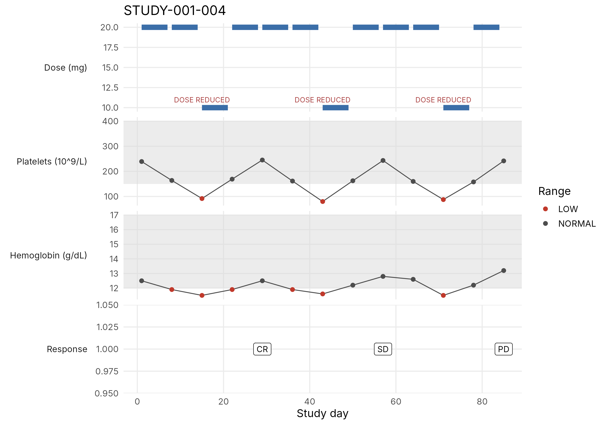

# Trial Explorer

An R/Shiny ([teal](https://insightsengineering.github.io/teal/)) app for exploring clinical trial ADaM data. It provides:

- blinded and unblinded views, with masking applied to the data before the app sees it;
- exposure against haematology over a shared study-day window (a patient profile and a cohort scatter);
- searching and plotting patient diary free text;
- a graph builder with a reviewed preset library;
- read-only final TFLs, checksum-verified, for completed studies.

See [DESIGN.md](DESIGN.md) for the design and the blinding rules.



## Run it in a Lifebit notebook session

The app runs inside your already-logged-in workspace. It does no authentication of its own (see [Roles](#roles)).

### 1. Get the code into the session

In a terminal in the session:

```bash
git clone https://github.com/Vbkotha/clinical_trial_data_Explorer.git
cd clinical_trial_data_Explorer
```

You can also upload a zip of the repository and unzip it.

### 2. Start the app

There is no separate install step. On first start the app installs teal and its other packages into your R library, which takes a few minutes. Later starts only check versions.
- teal packages come from the insightsengineering r-universe.
- Everything else comes from CRAN, as precompiled Linux binaries from Posit Package Manager when the OS is recognised.
- If the session can only reach an internal mirror, set `TRIAL_EXPLORER_REPOS=https://your-mirror/...` before starting.
- To install ahead of time, run `Rscript install.R`.

**RStudio session.** Open the project folder and run:

```r
source("launch.R")
run_trial_explorer(study = "STUDY-001", role = "blinded")
```

The app opens in the Viewer pane. Use the "Show in new window" button for a full browser tab, and press Stop (or Esc) to quit.

**Jupyter session (R kernel).** Open `notebooks/launch_trial_explorer.ipynb` and run the cells. It starts the app in a background R process:

```r
source("launch.R")
run_trial_explorer(study = "STUDY-001", role = "blinded", background = TRUE)
# ... later
stop_trial_explorer()
```

Then open `<your session URL>/proxy/3838/`. This needs jupyter-server-proxy in the Jupyter session. If that path returns 404, ask the platform team how the session exposes ports.

**Terminal.**

```bash
Rscript launch.R STUDY-001 blinded 3838        # foreground, Ctrl+C to stop
nohup Rscript launch.R STUDY-001 unblinded 3838 > ~/trial-explorer.log 2>&1 &   # background
```

The app listens on `0.0.0.0:<port>`, so the session's port proxy can reach it.

## Roles

| Role | Valid for | Sees |
|---|---|---|
| `unblinded` | any study | all data |
| `blinded` | ongoing studies | arm variables masked, `ADEX` dropped, diary text hidden |
| `viewer` | completed studies | final TFLs and locked data, no diary free text |

The role is chosen when you launch, through `role =` (or the `APP_ROLE` variable). The alternative is `APP_GROUPS`, a comma-separated list of groups mapped through `config/roles.yml`. If you set neither, the app uses the most restrictive role for the study.

Because whoever launches the app chooses the role, the blinded view only controls what the app displays. It is an access control only if the workspace user cannot read the unblinded source files directly. Per-user authentication can be added later in `get_identity()` (`R/auth.R`). See DESIGN.md §2.

## Configuration

| Setting | Where | Default |
|---|---|---|
| Study, data source, blinding spec, TFL folder | `config/studies.yml` | two synthetic demo studies |
| Group to role mapping | `config/roles.yml` | |
| Preset graphs | `config/graph_presets.yml` | |
| `APP_STUDY`, `APP_ROLE`, `APP_GROUPS`, `APP_USER` | environment (set by `run_trial_explorer()`) | `STUDY-001`, most restrictive, none, OS user |
| `APP_STATE_DIR` | environment: audit log and saved graphs | `~/.trial-explorer` |
| `AUDIT_LOG`, `GRAPH_LIBRARY_DIR` | environment: override the individual paths | under `APP_STATE_DIR` |

To use real data, set `source: files` and `data_dir:` in `config/studies.yml` to a folder of `adsl.parquet`, `adlb.sas7bdat`, `.xpt` or `.rds` files. Install `arrow` or `haven` with `TRIAL_EXPLORER_OPTIONAL=true Rscript install.R`.

## Tests

```bash
Rscript -e 'testthat::test_file("tests/test_core.R")'
```

## Files

```
app.R                     teal app: init(), module tree, locked filter, role banner
launch.R                  run_trial_explorer() / stop_trial_explorer() for notebook sessions
install.R                 ensure_packages(): installs missing packages on first start
notebooks/                Jupyter (R kernel) launcher notebook
config/                   studies, roles, graph presets
R/                        auth, access/blinding, data module, analysis modules, synthetic data
tests/test_core.R         unit tests
```
